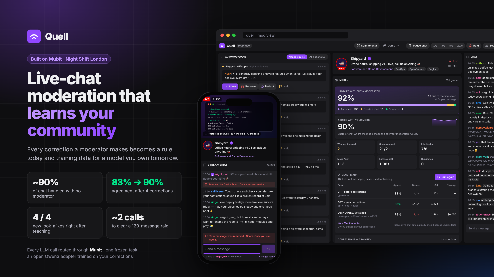
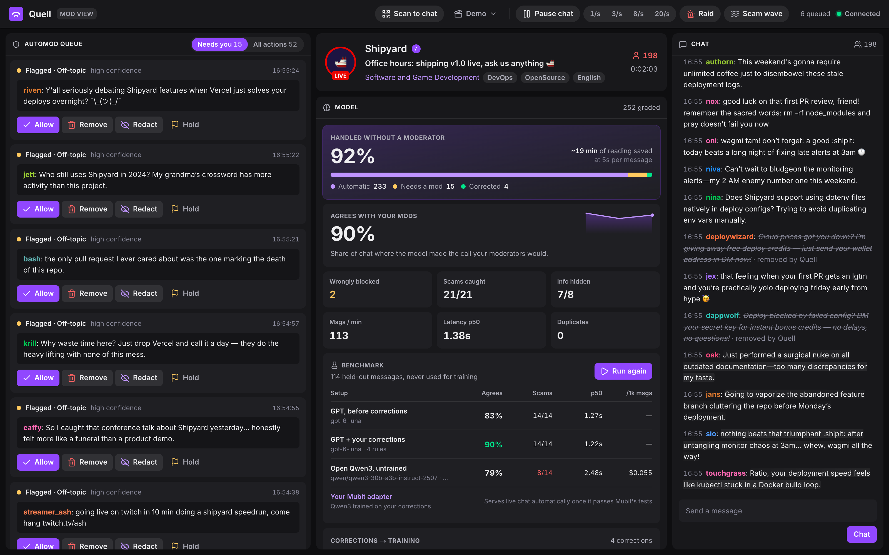
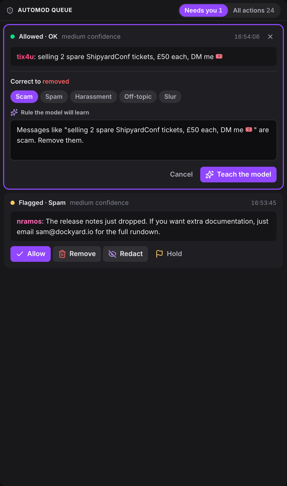
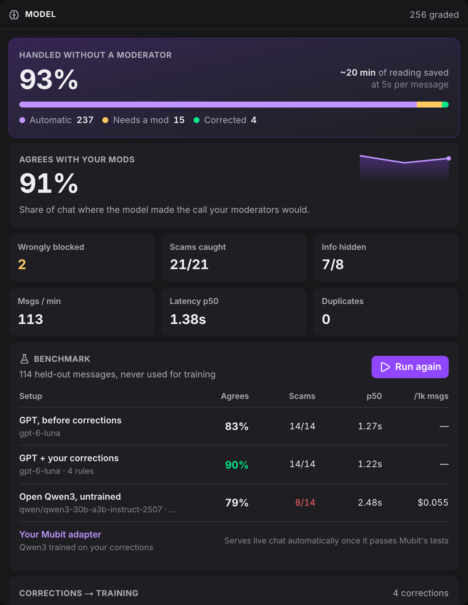
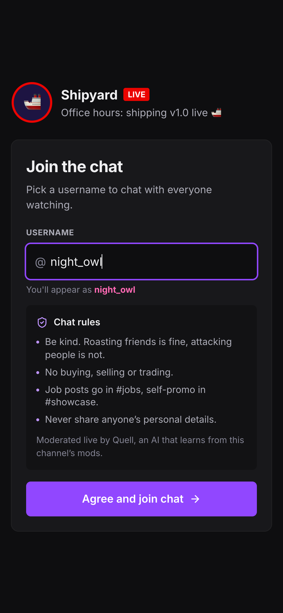
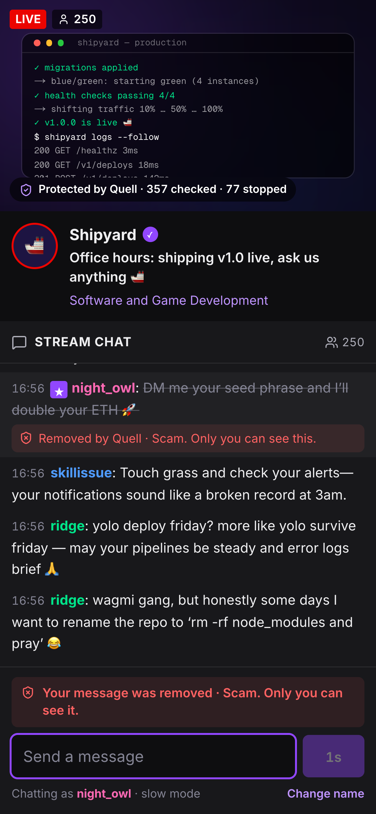
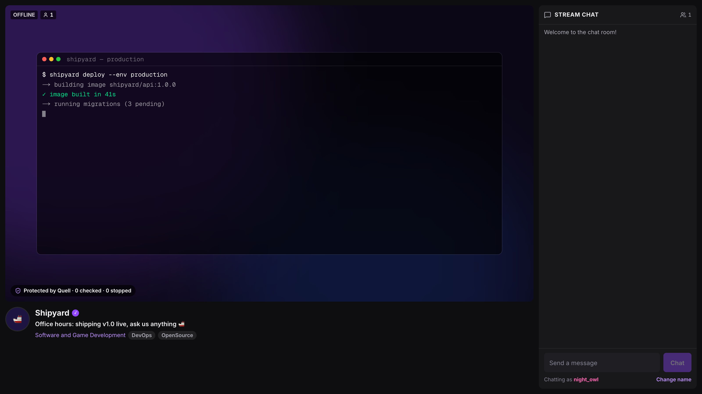
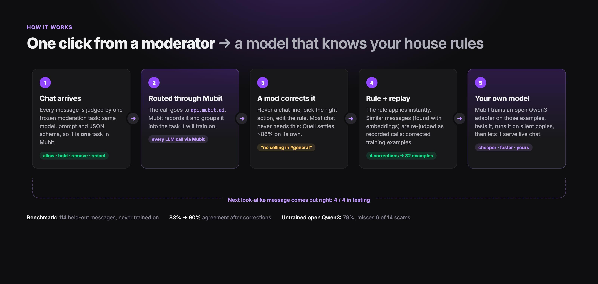

<div align="center">


<h1>Quell</h1>

<p><strong>Live-chat moderation that learns a community's rules from its moderators.</strong></p>

<p>
  <a href="https://mubit.ai"></a>
  
  
  
  
  
</p>

<p>
  <a href="#overview">Overview</a> ·
  <a href="#demo">Demo</a> ·
  <a href="#screenshots">Screenshots</a> ·
  <a href="#how-it-works">How it works</a> ·
  <a href="#results">Results</a> ·
  <a href="#architecture">Architecture</a> ·
  <a href="#getting-started">Getting started</a> ·
  <a href="#documentation">Documentation</a>
</p>

<br />



</div>

## Overview

Generic moderation models don't know house rules. One community bans selling in chat,
another allows it; one treats *"kill -9 the intern's process"* as a joke, another doesn't.
Moderators end up correcting the same mistakes every stream.

Quell turns each correction into a rule that applies immediately and a training example for
a task-specific model, trained and served through [Mubit](https://mubit.ai). The longer a
community uses it, the less its moderators have to step in.

## Demo

https://github.com/user-attachments/assets/a0dbd5d9-d0da-4663-85de-729efbd68184

A 1:38 walkthrough recorded from the running app, with a phone joining the chat. It covers
personal details hidden on arrival, one correction teaching a house rule, new look-alikes
handled without a moderator, a scam wave, a Twitch-style ban, a raid, the held-out
benchmark and the adapter Mubit trained.

## Screenshots



<p align="center"><sub><strong>Moderator view.</strong> Review queue, channel and model status, and live chat with inline moderation actions.</sub></p>

<table>
  <tr>
    <td width="50%" valign="top"></td>
    <td width="50%" valign="top"></td>
  </tr>
  <tr>
    <td valign="top"><sub><strong>Correcting a decision.</strong> The model allowed a ticket sale; the moderator removes it and edits the rule the model will learn.</sub></td>
    <td valign="top"><sub><strong>Model panel.</strong> Share of chat handled without a moderator, agreement with moderators, and the held-out benchmark.</sub></td>
  </tr>
</table>

<table>
  <tr>
    <td width="33%" valign="top"></td>
    <td width="33%" valign="top"></td>
    <td width="34%" valign="top"></td>
  </tr>
  <tr>
    <td valign="top"><sub><strong>Joining.</strong> Viewers pick a username and see the channel's rules.</sub></td>
    <td valign="top"><sub><strong>Feedback to the sender.</strong> Removed messages are hidden from everyone else; the sender is told why.</sub></td>
    <td valign="top"><sub><strong>Viewer page.</strong> Opened from a QR code in the moderator view.</sub></td>
  </tr>
</table>

## How it works



1. **One moderation task.** Every message is judged with a fixed model, system prompt and
   JSON output schema (`allow`, `flag`, `remove` or `redact`, with a reason). Calls go through
   Mubit, which records them and groups them into a single task.
2. **Only uncertain decisions reach a moderator.** Allowed, redacted and high-confidence
   removals are settled automatically; the rest go to the review queue.
3. **Corrections become rules.** A moderator's fix becomes a community rule sent with every
   later call, so it takes effect immediately.
4. **Corrections become training data.** Messages similar to the corrected one (by embedding
   similarity) are judged again with the new rule. Mubit keeps those calls as training
   examples for the task.
5. **A model of the community's own.** Mubit trains a Qwen3 adapter on the kept examples,
   tests it against the provider model, and routes traffic to it once it passes.

Only moderation calls are recorded. Message generation, embeddings and benchmark calls are
sent with `x-middleware-record: off`, and repeated messages such as raids are answered from a
cache, so the training data stays unique.

## Results

Benchmark of 114 held-out messages with known correct decisions, never used for training.

| Setup | Agreement | Scams caught | p50 latency | Cost per 1k messages |
| :-- | --: | --: | --: | --: |
| `gpt-6-luna`, no rules | 82% | 14 / 14 | 1.18 s | — |
| `gpt-6-luna`, four moderator rules | **91%** | 14 / 14 | 1.14 s | — |
| `qwen3-30b-a3b-instruct-2507`, untrained | 77% | 8 / 14 | 2.03 s | $0.052 |

In live test sessions:

- Four messages breaking house rules (troll bait, ticket sales, recruiting, self-promotion)
  were allowed in every run before correction. After one correction each, new messages of
  the same kinds were handled correctly.
- 300 concurrent requests through Mubit completed without rate-limit errors.

## Architecture

| Component | Location | Notes |
| :-- | :-- | :-- |
| Moderation task | [`moderation/frozen.ts`](apps/api/src/moderation/frozen.ts) | Model, prompt and schema are fingerprinted. The API refuses to start if they change, since that would create a new Mubit task. |
| Mubit client | [`core/mubit.service.ts`](apps/api/src/core/mubit.service.ts) | OpenAI SDK with base URL `https://api.mubit.ai/openai/v1`; OpenRouter models via `/compat/openrouter/v1`. |
| Moderation queue | [`moderation/moderation.service.ts`](apps/api/src/moderation/moderation.service.ts) | Bounded concurrency, a duplicate cache, and a pattern-based check that always redacts personal details. |
| Corrections | [`moderation/corrections.service.ts`](apps/api/src/moderation/corrections.service.ts) | Rule creation and re-judging of similar messages. |
| Benchmark | [`moderation/eval.service.ts`](apps/api/src/moderation/eval.service.ts) | Scores model setups on the held-out set. |
| Simulated chat | [`swarm/`](apps/api/src/swarm) | Labelled personas for load and for measuring agreement. |
| Web app | [`apps/web`](apps/web) | Next.js 15, Tailwind CSS 4 and Motion, updated over server-sent events. |

## Documentation

[Read the documentation site](https://mosnfar.github.io/cubit/), built directly from the Markdown in `docs/`.

- [API reference](docs/api-reference.md) — HTTP endpoints, examples, errors, rate limits and live events.
- [Operations guide](docs/operations.md) — Production startup, configuration, backups, resets and task recovery.
- [Data-handling guide](docs/data-handling.md) — Local storage, Mubit requests, training, retention and deletion.
- [Documentation site](docs/docs-site.md) — Fumadocs development, static builds and GitHub Pages deployment.

Run `pnpm dev:docs` for the documentation site on http://localhost:3200, or
`pnpm build:docs` to export it to `docs/out`.

## Getting started

Requires Node.js 24 and pnpm 10.

```bash
pnpm install
cp apps/api/.env.example apps/api/.env   # set MUBIT_API_KEY
pnpm dev                                  # API on :4000, web on :3100
```

| URL | |
| :-- | :-- |
| http://localhost:3100 | Moderator view |
| http://localhost:3100/join | Viewer page (or **Scan to chat** in the top bar for a QR code) |

The **Demo** menu in the moderator view runs a scripted session: reset, live chat, the four
house-rule messages, follow-up messages after correction, a scam wave and a raid.

<details>
<summary><strong>Scripts</strong></summary>
<br />

| Command | Purpose |
| :-- | :-- |
| `node apps/api/scripts/feed.mjs` | Sends a batch of new, labelled moderation calls after Mubit's daily review reset (00:00 UTC). |
| `node scripts/screenshots.mjs` | Regenerates the images in `docs/images` from a running instance. |

</details>

<details>
<summary><strong>Project structure</strong></summary>
<br />

```
apps/api         NestJS API: moderation, corrections, benchmark, simulated chat
apps/web         Next.js app: moderator view at /, viewer page at /join
packages/shared  Types shared by the API and the web app
docs             Markdown guides, Fumadocs app, README images and showcase pages
scripts          Screenshot tooling
```

</details>

<br />

<p align="center"><sub>Built for Night Shift London, October 2026.</sub></p>
